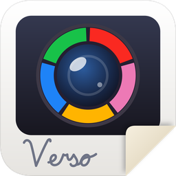
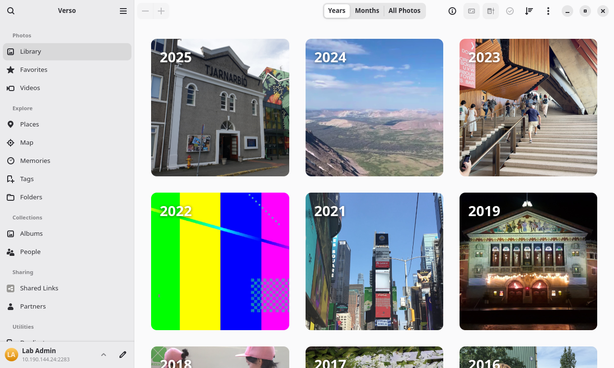
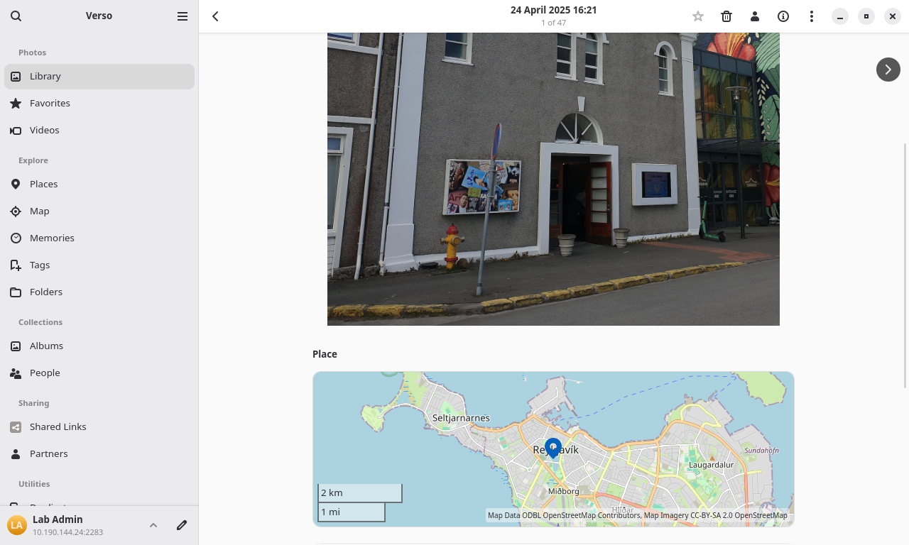
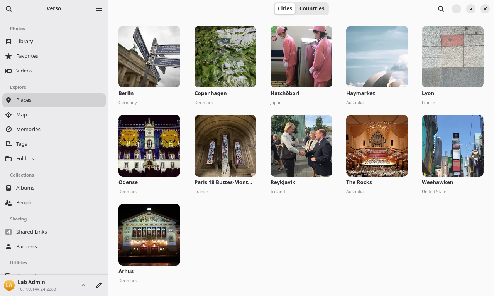
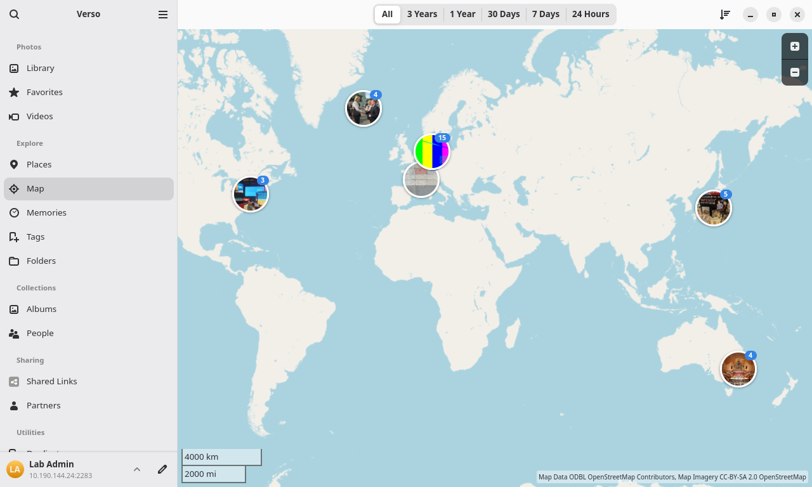
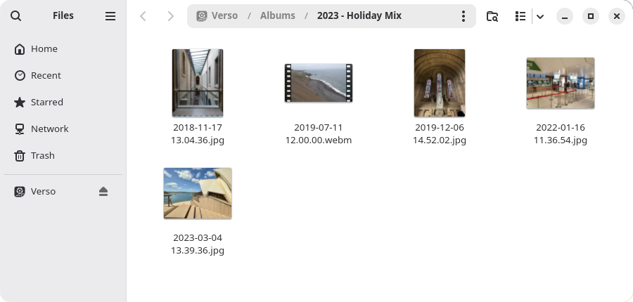

# Verso for Immich

**Your [Immich](https://immich.app) library on the Linux desktop: a gallery to browse, search and organise it, and,
when you want it, the library as a drive in Files.**

For **Linux** on x86_64, made for GNOME with GTK 4 and libadwaita.

> Verso is an independent, unofficial project. It is not affiliated with, endorsed by, or sponsored by the Immich
> project or FUTO. "Immich" is used only to describe the server this software works with, and remains the mark of
> its owner.



## What it does

- **Your whole library:** the timeline by year, by month or every photo, with a date scroller along its edge;
  albums, people, places and the map, memories, tags, folders, shared links, partners, duplicates, the archive, the
  trash and the Locked Folder.
- **A viewer for the keyboard and the touchpad:** photos slide in from the side and follow a touchpad swipe; videos
  and Live Photos play; the photo's people, place, camera and file are a scroll down. Down shows them and Up goes
  back to the photo, and Space opens a photo from the grid and closes it again.
- **Search** by what photos show, by text in them, by file name or description, narrowed by people, places, dates
  and cameras.
- **Organise and share:** favorites, albums, stacks, dates and locations, the archive, the trash and the Locked
  Folder; shared links for albums and photos; photos and folders imported from your computer.
- **Verso Drive, when you want it:** your library as folders in Files and in every file dialog, so any program can
  open a photo. Originals download only when something opens them. It is off until you switch it on in Preferences.
- **An icon in the top bar** while you are signed in: it opens Verso, mounts and unmounts the drive, and keeps the
  drive working when the window is closed. A double click opens Verso.
- **Works with other Immich apps:** Verso takes part in [Immich Crosslink](https://jakob.hviid.phd/immich-crosslink/),
  so **Show in** opens the same photo, album, person or place in another app that takes part, and those apps can
  show theirs in Verso.
- **Sign in your way:** with your server's single sign-on in your own browser, with email and password, or with an
  API key. The sign-in stays in your keyring. Where [Immich Mount](https://jakob.hviid.phd/immich-mount/) is signed
  in, Verso offers to take its account over.
- **Your account and server:** your profile, password, devices and API keys, and for an admin, the server's
  administration.

<table>
  <tr>
    <td></td>
    <td></td>
  </tr>
  <tr>
    <td></td>
    <td></td>
  </tr>
</table>

## Install

### With Homebrew

```sh
brew install jakobhviid/tap/verso
```

Open **Verso** from the app grid and sign in. Update with `brew upgrade verso`; remove it with `brew uninstall verso`,
and add `--zap` to remove its settings and cache too.

It needs:

- x86_64 Linux with GTK 4.18 or later and libadwaita 1.8 or later (Fedora 44 or similar).
- FUSE 3, for Verso Drive.
- nautilus-python, for Verso's menu in Files.
- A tray for the top bar icon: KDE Plasma has one; on GNOME, the AppIndicator extension.

### As a Flatpak (test build)

Download `verso-x86_64.flatpak` from the [latest release](https://github.com/jakobhviid/verso-releases/releases/latest),
then:

```sh
flatpak install --user verso-x86_64.flatpak
flatpak run dev.hviid.Verso
```

It fetches the GNOME runtime from Flathub. The Flatpak is Verso without the parts that need access outside its
sandbox:

- **No Verso Drive,** so no Show in Files and no Verso menu in Files. Preferences points to the Homebrew version,
  which has it.
- **Show in** is one **Show in Another App…**, where you choose the app, as a sandboxed app cannot list the others.
  Other apps still show their items in Verso.
- **No taking over Immich Mount's account:** you sign in as usual.
- **Starting at login** is asked by your desktop the first time you sign in.

## Status

These are evaluation builds: Verso is young and changes quickly. Problems and ideas are welcome in this
repository's [issues](https://github.com/jakobhviid/verso-releases/issues). This repository holds the releases; the
releases up to 0.3.1 were named Immich Gallery for Linux.

## Credits

- The interface follows **[Immich Gallery](https://github.com/IGOLz/ImmichGallery)** for the Mac, by Alessandro
  Craciun.
- The drive, the service and the Immich API layer are
  **[Immich Mount](https://jakob.hviid.phd/immich-mount/)**'s; its API layer started from
  **[immich-rs](https://github.com/boul2gom/immich-rs)** (MIT).
- **[Immich](https://github.com/immich-app/immich)**, the server all of this talks to.
- The photos in the screenshots are Immich Mount's test library, Creative Commons and public domain photos from
  Wikimedia Commons, each credited in its
  [ATTRIBUTION.md](https://github.com/jakobhviid/immich-mount/blob/main/lab/immich-server/fixtures/ATTRIBUTION.md).
  Map data and imagery are OpenStreetMap's, as credited on the map.

## AI disclosure

Parts of this project were written with the assistance of AI coding agents. All changes are reviewed by the maintainer.
This is the single place that fact is disclosed; it is deliberately kept out of the commit history.
